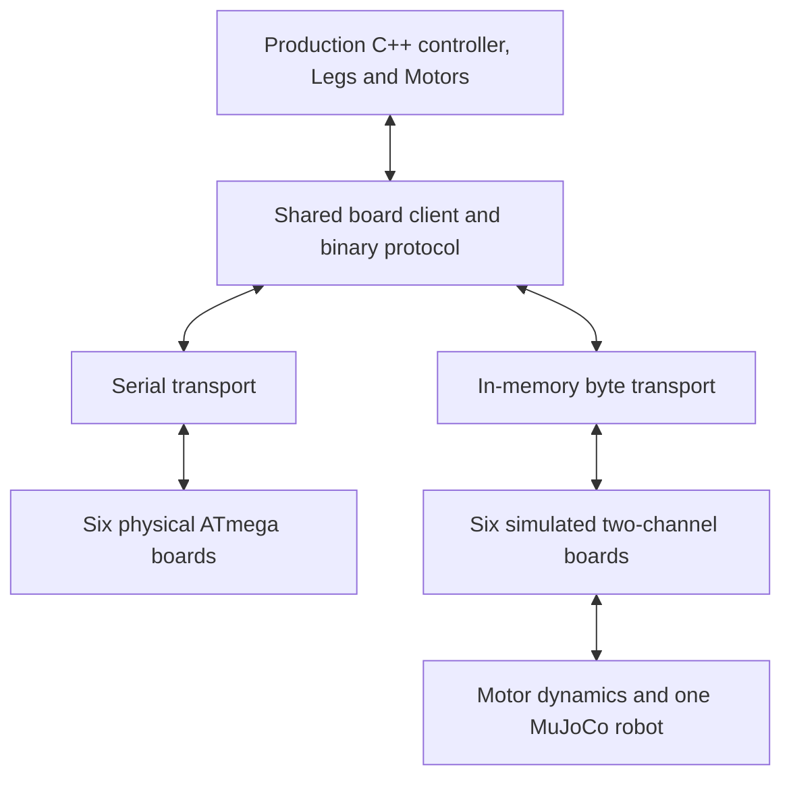

# Swappable hardware and simulated motor boards

Date: 2026-10-25. Status: software integration implemented; physical validation
remains open. See [simulated-boards.md](simulated-boards.md) for commands and
implementation details.

| Phase | Current status |
| --- | --- |
| 1. Protocol/baseline | Active command contract, protocol/encoder fixtures and model checks implemented. Ambiguous firmware commands are explicitly unsupported. |
| 2. Shared client/transport | Implemented with synchronous pumping, serial and memory transports, lifecycle fixes and tests. |
| 3. Board emulator | Implemented; state/setup/telemetry/reset/fault tests, 4 s execution watchdog and blocking 15 ms thermal watchdog. Temperature acquisition timing/filtering remains approximate. |
| 4. Native plant | Six-board mapping, native MuJoCo and per-motor heating/cooling implemented; electrical/thermal parameters and sensor placement remain unmeasured. |
| 5. Controller runner | Implemented, including repeatable traces, stop, timestep checks and optional visualization. Complete reset uses fresh-run reconstruction, not an interactive in-process reset API. |
| 6. Runtime/homing | Backend selection and short known-pose ground stance through host rotor-PD voltage control implemented. Physical stops, absolute references, real homing and sustained thermal performance remain open. |
| 7. PTYs | Six-port emulator server and serial-backend integration test implemented. |

The original baseline and acceptance checklist below retain their planning
context. Checked items indicate implemented software; they do not claim measured
hardware equivalence.

## Objective and original baseline

Run the production C++ controller against either six physical ATmega328P boards
or six simulated two-channel boards. Preserve the controller's binary commands,
feedback processing, leg differential, and board/channel mapping. Select the
backend at startup without changing leg-control or behavior code.

At plan creation the PC controller opened serial devices and a joystick. Its
`ControllerType` switch refers to the unfinished Gazebo driver. The MuJoCo
prototype in `sim/robot_model.py` is separate: `robot_demo.py` uses demonstration
rotor position servos, not the production controller or voltage commands.

The selected motor shaft torque ceiling is **3,000 gf·cm = 0.2941995 N·m**.
The demonstration held a stance for ten simulated seconds at this setting.
This is a chosen simulation limit, not an identified motor model. CAD alignment,
mechanical stops, encoder references, and other physical parameters still need
validation. Existing draft model tests must be reviewed and made into a passing
baseline; a successful demo is not a substitute for that baseline.

This plan follows the architecture selected in
[simulator-research.md](simulator-research.md). Historical findings are in
[repository-notes.md](repository-notes.md); current build boundaries are in
[build.md](build.md).

## Architecture

Keep the existing board-facing operations available to `Motor` and the behavior
code. Refactor `BLDCDriverBoard` into a common client with injected transport and
clock dependencies. Its templated command helpers can remain ordinary wrappers
around the shared codec; they do not need to become virtual methods.

Implement the reusable client, emulator, and deterministic runner in C++.
The primary runner will use the native MuJoCo API and the same MJCF assets as the
Python prototype. Native MuJoCo integration is a new Bazel dependency boundary;
the original Python wheel setup alone did not establish a C++ build interface.
The implemented native target now exports that pinned wheel's headers/library.
Keep MuJoCo out of the hardware-only Odroid dependency graph.

| Component | Contract |
| --- | --- |
| Board client | Encode commands, incrementally decode replies, manage synchronization and pending requests, publish feedback to `Motor`. |
| Byte transport | Nonblocking read/write with explicit progress, would-block and disconnect results; connection/reset operations and transmit backlog. |
| Serial transport | Own file descriptor, termios, serial-specific ioctls and physical reset. Handle partial I/O and unsupported device capabilities explicitly. |
| In-memory transport | Paired byte queues with deterministic delivery times, bounded capacity, configurable latency and serial bandwidth. |
| Simulated board | Own two channels, configuration, command parser, state machine, telemetry schedule and reset state. No physics stepping. |
| Motor plant adapter | Convert board voltage outputs to shaft torques and rotor motion to sensor readings. Bind channels by configured motor names. |
| Runner | Advance the common clock, all transports, six boards and one physics model; schedule controller updates and scripted/user input. |

No board owns a separate robot or steps MuJoCo independently. Z boards serve
motors on different legs, and all twelve motors act on the same coupled plant.

## Implementation phases

### 1. Establish the protocol and regression baseline

- [x] Inventory commands actually sent by startup, motor/leg testing, stop,
  reset and initialization. Compare shared protocol headers with the active
  `base/binary_commander.cc` handlers and firmware state machine.
- [x] Specify byte order, signed widths, channel bits, command/subcommand
  lengths, reply framing and telemetry layouts. Resolve discrepancies in GET
  replies/sequence bytes and unsupported commands before emulating them.
- [x] Record synchronization, availability, configuration, INIT, STOPPED and
  RUNNING exchanges as byte-level fixtures derived from source. Distinguish
  these from future recordings of real hardware.
- [x] Test the production `Motor` angle accumulator, including a nonzero first
  reading, wrap in both directions and reconnect/reset. Existing angle tests
  use a copied motor implementation and are insufficient for this boundary.
- [x] Capture model validation results and unresolved assumptions. Separate
  linkage mobility from ground-contact constraints in model checks; keep
  reference load tests explicit about their torque limits.

Acceptance: a documented active protocol and tests that expose incorrect frame
handling and encoder accumulation. Do not infer behavior from obsolete firmware
programs or silently implement commands the active firmware ignores.

### 2. Separate the common client from serial transport

- [x] Introduce a byte-transport interface and injectable monotonic clock.
  Move POSIX serial calls and hardware reset into the serial implementation.
- [x] Extract incremental framing/serialization into portable code with no
  Arduino or MuJoCo dependencies. Use explicit fixed-width byte operations,
  rather than unaligned casts or native object representation.
- [x] Review and fix the existing partial-write pointer handling, disconnect
  descriptor/state handling, communication-thread lifetime, callback ownership,
  pending-reply removal and replayed reply queues. Test failure paths directly.
- [x] Make client progress callable without its own thread. Hardware may retain
  an I/O worker; simulation must be able to pump the same client synchronously.
  Define ownership of feedback and queues to avoid communication/control races.
- [x] Replace scattered Gazebo `ControllerType` selections with one common
  board client. Preserve PC/AVR platform boundaries and hardware configuration.

Acceptance: hardware host targets still build; a fake byte transport can drive
the production client through fragmented/combined frames, short writes,
would-block, disconnect and reconnect without loss or duplicate callbacks.
No robot execution or deployment is required for this phase.

### 3. Implement one simulated two-channel board

- [x] Add a transport-independent board emulator driven by supplied time and
  sensor samples. Reuse protocol definitions and portable logic where practical;
  do not compile AVR register, PWM or I2C code into the simulator.
- [x] Implement the active synchronization/setup exchanges, channel availability,
  configuration registers and legal state transitions. Model initialization
  delays as scheduled events, not sleeps or unconditional acknowledgements.
- [x] Accept voltage commands in signed 16-bit units of 1/512 V. Publish
  alternating two-channel encoder/temperature packets with the actual framing.
- [x] Define output behavior in disabled, stopped, reset and error states from
  the active firmware. If a desired fault response differs, record it as an
  explicit contract change rather than silently giving simulation extra behavior.
- [x] Distinguish the firmware execution watchdog from communication inactivity.
  The original host timeout handler was disabled; do not assume a working
  command-loss stop exists. Test the agreed timeout/reset behavior explicitly.
- [x] Initially provide a documented fixed temperature and injectable faults.
  Fixed samples have since been replaced in the runner by modeled temperatures,
  delivered through the simulated boards (see phase 4).

Acceptance: production client + emulator complete setup, run, stop and reset
against a simple sensor/actuator fixture. Channels remain independent; malformed
or unsupported commands follow the specified contract.

### 4. Connect six boards to the MuJoCo plant

- [x] Add a pinned native MuJoCo dependency compatible with the existing model
  and Python baseline. Package MJCF and meshes as Bazel runfiles; verify loading
  outside the checkout working directory. Hardware builds must not acquire
  simulator libraries or graphics dependencies.
- [x] Instantiate six board emulators from the existing robot YAML and bind
  all twelve channels by motor name. Validate uniqueness, completeness and the
  host FR/FL/BR/BL to CAD RF/LF/RB/LB mapping. Avoid a second independent board map.
- [x] Load plain torque-driven actuators. Do not enable `configure_demo_servos`
  when the production controller is active.
- [x] Add an explicit voltage-to-torque model with supply/modulation saturation,
  speed dependence and the selected shaft torque ceiling. Keep motor constants
  and loss assumptions separate from measured electrical calibration.
- [x] If constants are unavailable, use a named, configurable approximation
  for bring-up and document its gain and limitations. The torque ceiling alone
  cannot determine volts-to-torque gain. Later identify torque constant,
  effective resistance and back-EMF; add current dynamics if required.
- [x] Include a lumped thermal state and
  feed temperature samples for all twelve channels into the six simulated
  boards. Model heating from electrical losses and cooling toward configurable
  ambient temperature using simulation time. Document unmeasured thermal
  parameters as assumptions.
- [ ] Identify the physical sensor location and distinguish its reading from
  winding temperature where needed. The implemented single-node approximation
  does not yet model sensor lag or firmware ADC/median filtering.
- [x] Transmit those samples through the existing encoder/temperature packet
  schedule and shared client to `Motor::GetTemperature()`, using the firmware's
  units and whole-degree wire representation. Exercise over-temperature behavior with
  modeled sensor readings, without changing the hardware protocol.
- [x] Test heating under load, cooling after stop, independent channel mapping,
  repeatability, and temperature delivery through both memory and PTY transports.
  Board resets must preserve the plant's physical temperature; a complete
  simulation reset must restore the configured initial thermal state.
- [x] Apply shaft torque once through MuJoCo's differential actuators. Derive
  rotor position/velocity from the same transmission; do not apply the 9:1
  reduction again in the board adapter or feed joint angles back as encoders.
- [x] Quantize rotor position to 4096 counts/revolution and wrap correctly for
  negative angles. Define mechanical zero, sensor direction and calibration
  semantics explicitly. Ideal corrected telemetry must not receive measured
  encoder correction twice; electrical zero is not mechanical homing zero.

Acceptance: a voltage command traverses the production client, byte transport,
board state machine and motor model, moves the appropriate differential, and
returns quantized feedback through the production decoder. Test all twelve
channels, reverse direction, encoder wrap, saturation, and stopped outputs.

### 5. Run the production controller deterministically

- [x] Create a simulation runner using the existing controller library and
  injected inputs. Make joystick access optional; support scripted control
  events for headless tests.
- [x] Replace blocking behavior/startup sleeps with elapsed-time states. Route
  synchronization, deadlines and reset scheduling through the injected clock.
- [x] Start with 0.5 ms physics substeps and nominal 5 ms control updates.
  Define exact sample/delivery/control ordering and use integer clock ticks.
  Review existing fixed-dt PID code and accumulated dt behavior so delays are
  handled deliberately, rather than changing effective control gains silently.
- [x] Pump transport and board state machines independently of
  `Controller::Update` backpressure. Queued commands must drain even when leg
  updates are skipped. Physics and deadlines must also continue to advance.
- [x] At each substep, deliver due bytes/events, apply stored board outputs to
  the plant, step physics, sample due telemetry and schedule its transmission.
  Run due controller updates at a documented boundary using delivered samples.
- [x] Model 115200-baud byte timing and bounded queues in the realistic profile;
  keep any zero-latency test profile explicit. Do not invent a fixed firmware
  telemetry rate where the source currently sends according to buffer capacity.
- [x] Support repeatable reset of physics, clock, queues, boards, motor angle
  accumulators, PIDs and behavior state. Fresh-run reconstruction is implemented
  and tested; an interactive complete reset remains open. Real-time pacing is
  optional, and headless runs do not sleep.

Acceptance: identical configuration, seed and scripted events reproduce traces
on the same build. Pausing rendering does not alter simulation time semantics.
Backpressure and reset tests complete without deadlock. Compare trajectories
and closure error at 0.5 ms and 0.25 ms physics steps.

### 6. Make startup selection and homing reviewable

- [x] Add explicit runtime backend selection to the PC entry point. Proposed
  options `--backend=serial` and `--backend=sim` are now implemented. Preserve the same robot calibration and channel mapping, with a
  separate simulation-parameter configuration.
- [x] Construct only the selected backend: simulation must not open hardware
  serial devices, initialize a joystick implicitly or fall back to hardware
  after a simulator error. Hardware-only builds may omit the sim factory.
- [ ] Reconcile CAD joint signs, mechanical limits and absolute encoder/homing
  references before exercising the real homing sequence. Current unconstrained
  hinges cannot reproduce initialization that seeks physical stops.
- [ ] Validate each leg's initialization and stand-up behavior, then the full
  robot. Keep a known-pose, non-homing bring-up scenario available and clearly
  identified while mechanical references are unresolved.
- [x] Add `stand` for the demo pose on the ground, using temporary startup
  support and a host rotor-PD policy through normal voltage commands. Verify
  an eight-second run, all four feet in contact, pose/torque bounds,
  repeatability and timestep convergence. Thermal resets remain active and
  end longer runs with the current unmeasured thermal parameters.
- [x] Document launch commands, backend selection, parameter provenance and
  validation results. Keep the existing independent demo available for geometry
  inspection, clearly distinguished from the production-controller runner.

Acceptance: switching the startup backend requires no behavior or leg-control
edits. Full initialization is marked complete only after it works with modeled
stops and verified reference conventions; a bypassed initialization is not a
passing homing test.

### 7. Add pseudo-terminal integration coverage

- [x] Expose the same emulator core through six Linux pseudo-terminals, without
  creating another implementation of board behavior.
- [x] Supply a temporary device-address overlay, leaving measured calibration
  untouched. Define simulated reset separately: a PTY does not automatically
  emulate a USB adapter's reset line or serial-specific ioctls.
- [x] Exercise the actual serial transport against the emulator in real time,
  including fragmented traffic, disconnects and reconnects.

Acceptance: the serial client communicates with the emulated boards through
ordinary terminal file descriptors. This complements deterministic in-memory
tests; OS scheduling means it is not the primary reproducibility mechanism.

## Validation and build boundaries

Each phase should land with focused tests and its acceptance results. Use:

- Protocol fixtures and production-client tests for framing and lifecycle.
- Board state-machine tests for startup, commands, telemetry and reset.
- Motor-model tests for units, polarity, torque saturation and encoder wrapping.
- Differential tests for power consistency and correct motor/channel mapping.
- Headless controller/plant scenarios for deterministic timing and fault cases.
- PTY integration tests for the real serial path.

Continue the existing PC controller build, active AVR build and simulator
dependency smoke test as applicable. Do not use blanket builds of deprecated
firmware or deployment/hardware execution as routine validation. Odroid
cross-toolchain restoration remains deferred in [TODO.md](../TODO.md).

## Primary source locations

| Source | Relevance |
| --- | --- |
| `src/odroid_controller/bldc_driver_board.{h,cc}` | Shared client and codec entry points; transport now lives in `boards/`. |
| `src/odroid_controller/motor.{h,cc}` | Board dependency, telemetry and encoder accumulation. |
| `src/odroid_controller/controller/main.cc` | Construction, backend selection, joystick and wall-clock loop. |
| `src/odroid_controller/controller.cc` | Backpressure, behaviors, initialization and blocking sleeps. |
| `src/odroid_controller/leg_controls.{h,cc}` | Voltage commands, control timing and homing. |
| `src/libs/communication/binary_{commands,stream}.h` | Shared protocol declarations. |
| `src/mcu_firmware/base/binary_commander.{h,cc}` | Active parser, replies, configuration and telemetry. |
| `src/mcu_firmware/controller/main_loop.cc` and `base/main.cc` | Active board states, motor enable/disable, watchdog and temperature behavior. |
| `src/odroid_controller/controller/config/robot_config.yaml` | Authoritative board/channel mapping and measured calibration. |
| `sim/robot_model.py`, `sim/robot_parameters.json`, `sim/mujoco/quadbot.xml` | Candidate physical model, assumptions and generated asset. |

## Deferred beyond this implementation

AVR instruction emulation, detailed PWM switching, deprecated calibration
firmware, Gazebo restoration, web-server rework, learning environments and GPU
training are outside this plan. Hardware measurements remain necessary before
claiming that simulated motor response and homing match the real robot.
